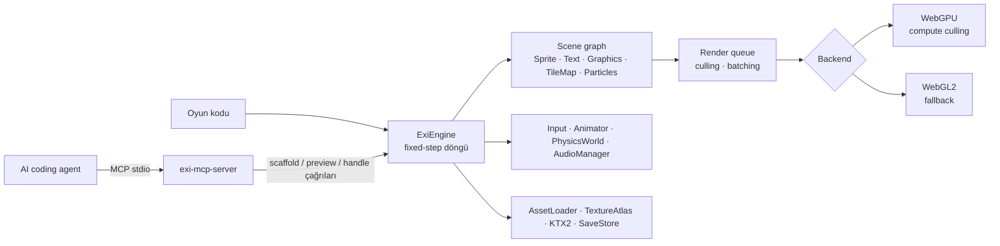

[](https://github.com/ozkantasli/ExiEngine/actions/workflows/ci.yml)
[](package.json)
[](.github/workflows/ci.yml)
[](ADR-001-language-graphics-api.md)
[](package.json)
[](test/unit)
[](CONTRIBUTING.md)

**Kendi çekirdeğiyle çalışan, sıfır bağımlılıklı 2D oyun motoru.**
ExiEngine; sahne grafiği, sprite batching, tilemap, particle, fizik, input, ses ve
asset yükleme katmanlarını tek bir JavaScript API'sinde toplar ve WebGPU'yu
öncelikli, WebGL2'yi yedek backend olarak kullanır. Çalışma zamanında başka bir
oyun motoruna ya da npm paketine bağlı değildir; Node.js yalnızca demo sunucusu,
testler ve MCP köprüsü için gerekir.

Onu diğer 2D motorlardan ayıran şey **AI-native** olmasıdır: yerleşik MCP köprüsü
sayesinde Claude Code, Codex, Gemini CLI, Cursor gibi coding agent'lar motoru
keşfedebilir, oyun iskeleti kurabilir, sahne üretebilir ve sonucu gerçek tarayıcıda
doğrulayabilir.

> **Önizleme (v0.2):** API, yapılandırma ve davranış sürümler arasında değişebilir.
> Node testleri gerçek GPU kanıtının yerine geçmez; fiziksel mobil cihaz matrisi
> henüz tamamlanmadı. Bkz. [Bilinçli sınırlar](#bilinçli-sınırlar).

[Başlarken](#başlarken) · [Dokümantasyon](#dokümantasyon) · [API](API.md) ·
[AI ajanlarıyla kullanım](#ai-ajanlarıyla-kullanım) · [Katkı](CONTRIBUTING.md)

## Özellikler

⚡ WebGPU-first, otomatik WebGL2 fallback ve device-loss kurtarma</br>
📦 Sıfır runtime bağımlılığı, tek `import`</br>
🧩 Scene graph: Sprite, Text, Graphics, TileMap, ParticleEmitter, NineSlice, RenderGroup</br>
🚀 Instanced `SpriteBatch` ve WebGPU compute culling ile 100.000 sprite'a kadar tek batch</br>
🗺️ Instanced TileMap, çarpışma kutusu üretimi ve A* yol bulma</br>
🧱 Hafif fizik: gravity, one-way platform, kinematic platform, layer/mask, temas olayları</br>
🎮 Klavye, pointer, dokunmatik ve gamepad için tek action/axis input katmanı</br>
🔊 Web Audio `AudioManager`: bus, fade, pan, voice bütçesi</br>
🎨 Pixel-art dostu: nearest sampling, `roundPixels`, flipX/flipY, atlas animasyonları</br>
🛡️ Güvenli varsayılanlar: aynı-origin asset, byte/pixel bütçeleri, sabit shader'lar, CSP</br>
🤖 MCP köprüsü: ajanlar motoru keşfeder, oyun kurar, tarayıcıda doğrular</br>
📐 TypeScript tanımları (`index.d.ts`), 201 unit test ve 25 allocation benchmark'ı</br>

Tam liste ve davranış ayrıntıları: [FEATURES.md](FEATURES.md)

## Başlarken

| Hedefiniz | Buradan başlayın | Elde ettiğiniz |
|---|---|---|
| **Motoru denemek** | [Demoyu çalıştırın](#demoyu-çalıştırın) | Auto / WebGL2 / WebGPU arasında geçiş yapılabilen canlı sahne ve FPS/draw/node ölçümleri |
| **Oyun yazmak** | [Hızlı başlangıç](#hızlı-başlangıç) ve [API.md](API.md) | Sahne, kamera, input ve fizikle çalışan ilk oyun döngünüz |
| **AI ajanıyla oyun kurmak** | [AI ajanlarıyla kullanım](#ai-ajanlarıyla-kullanım) | MCP üzerinden iskelet, sahne üretimi ve tarayıcı önizlemesi |
| **Katkı vermek** | [Geliştirme](#geliştirme) | Test, lint, coverage ve release kapısı |

### Demoyu çalıştırın

**Node.js 22 veya 24** yeterlidir; `npm install` gerekmez.

```bash
git clone https://github.com/ozkantasli/ExiEngine.git
cd ExiEngine
npm run dev
```

Ardından tarayıcıda `http://127.0.0.1:4173/` adresini açın. Sunucu yalnızca loopback
adresinde dinler ve CSP/`nosniff` başlıklarıyla çalışır.

### Hızlı başlangıç

Paket henüz npm'de yayımlanmadı; repo içindeki `src/index.js` dosyasını doğrudan
import edin.

```js
import { ExiEngine, Scene, Sprite, Camera } from "./ExiEngine/src/index.js";

const scene = new Scene();
const player = new Sprite({
  x: 100, y: 100, width: 32, height: 32, tint: 0x6fffc0,
  onUpdate: (dt, node) => { node.position.x += 120 * dt; },
});
scene.add(player);

const engine = await ExiEngine.create({
  canvas: document.querySelector("canvas"),
  renderer: "auto",            // "webgpu" | "webgl2" | "auto"
  backgroundColor: "#060912",
  scene,
  camera: new Camera(),
  inputActions: { jump: ["Space", { type: "gamepad", button: 0 }] },
});
engine.start();
```

Kamera takibi, overlay HUD, RenderTexture, fizik ve pointer olayları için örnekler
[API.md](API.md) içindedir.

## Genel bakış



| Klasör | İçerik |
|---|---|
| [`src/core`](src/core) | Engine, scene graph, renderable'lar, kamera, input, animasyon, çarpışma/fizik, pathfinding, profiler |
| [`src/render`](src/render) | WebGPU ve WebGL2 renderer'ları, batching, instancing, scissor, post-process |
| [`src/assets`](src/assets) | AssetLoader, Texture, RenderTexture, TextureAtlas, KTX2, SaveStore |
| [`src/audio`](src/audio) | Web Audio tabanlı AudioManager |
| [`src/ai`](src/ai) | Tarayıcı içi RuntimeAgent (MCP preview çağrılarının hedefi) |
| [`tools`](tools) | Sıfır bağımlılıklı MCP köprüsü ve lint aracı |
| [`test`](test) | Smoke, unit, typecheck, coverage, e2e ve benchmark'lar |

Grafik API ve dil seçiminin gerekçesi [ADR-001](ADR-001-language-graphics-api.md) içindedir.

## AI ajanlarıyla kullanım

Repo, yaygın AI CLI'ları için hazır MCP yapılandırmasıyla gelir. Ajan klasörü
açtığında `exi-engine` sunucusunu otomatik bulur.

| İstemci | Yapılandırma |
|---|---|
| Claude Code | [`.mcp.json`](.mcp.json), [`CLAUDE.md`](CLAUDE.md) |
| Codex | [`.codex/config.toml`](.codex/config.toml), [`AGENTS.md`](AGENTS.md) |
| OpenCode | [`opencode.json`](opencode.json), [`AGENTS.md`](AGENTS.md) |
| Gemini CLI | [`.gemini/settings.json`](.gemini/settings.json), [`GEMINI.md`](GEMINI.md) |
| Cursor CLI | [`.cursor/mcp.json`](.cursor/mcp.json) |
| Cline CLI | [`.cline/mcp.json`](.cline/mcp.json) |
| Windsurf / diğerleri | [MCP.md](MCP.md) içindeki doğrudan Node komutu |

Köprüyü elle başlatmak için:

```bash
node tools/exi-mcp-server.mjs
```

> MCP stdio komutu olarak `npm run mcp` kullanmayın; npm başlığı stdout'a karışır.

Tipik ajan akışı: `exi_api` ile motoru keşfet → `exi_scaffold` (yeni oyun) veya
`exi_project_open` (mevcut oyun) → `exi_project_apply` ile dosyaları yaz →
`exi_project_preview` ile kontrol edip tarayıcıda aç → `exi_preview_call` ile
canlı motor state'ini doğrula. Tüm araçlar ve güvenlik limitleri:
[AI_ENGINE_GUIDE.md](AI_ENGINE_GUIDE.md), [MCP.md](MCP.md).

## Geliştirme

| Komut | Ne yapar |
|---|---|
| `npm run doctor` | Ortam, export ve agent-contract hızlı kontrolü |
| `npm test` | Statik, server, engine smoke, unit ve typecheck aşamaları |
| `npm run test:unit` | Yalnızca unit testler |
| `npm run lint` | Sıfır bağımlılıklı sözdizimi ve anti-pattern taraması |
| `npm run test:coverage` | Unit suite coverage eşikleri |
| `npm run test:mcp` | Modern ve legacy MCP uçtan uca smoke testi |
| `npm run test:clients` | Repo'daki her istemci config'inin gerçek handshake testi |
| `npm run verify` | Release kapısı: `npm test` + tüm benchmark'lar |
| `npm run bench:regression` | Yerel baseline'a göre benchmark sapma kontrolü |
| `npm run bench:<ad>` | Tekil benchmark (`streaming`, `sprite`, `tilemap`, `physics` …) |

CI ([`ci.yml`](.github/workflows/ci.yml)) her push ve PR'da Node 22 ve 24 üzerinde
test, lint, typecheck, verify, coverage ve preview-e2e job'larını çalıştırır.

Gerçek GPU/ses/input soak testi için demo sunucusu açıkken
`http://127.0.0.1:4173/test/hardware-soak.html` sayfasını kullanın. Fiziksel cihaz
sonuçları [test/HARDWARE_MATRIX.md](test/HARDWARE_MATRIX.md) üzerinden toplanır.

## Dokümantasyon

| Konu | Belge |
|---|---|
| Örnekli runtime ve MCP API referansı | [API.md](API.md) |
| Ajan ve katkı sözleşmesi (canonical) | [AI_ENGINE_GUIDE.md](AI_ENGINE_GUIDE.md) |
| MCP istemci kurulumları | [MCP.md](MCP.md) |
| Tüm özellikler ve davranış ayrıntıları | [FEATURES.md](FEATURES.md) |
| Tehdit modeli ve güvenlik sözleşmesi | [SECURITY.md](SECURITY.md) |
| Ürün gereksinimleri | [PRD.md](PRD.md) |
| Yol haritası | [ROADMAP.md](ROADMAP.md) |
| Diğer motorlarla karşılaştırma | [ENGINE_FEATURE_MATRIX.md](ENGINE_FEATURE_MATRIX.md), [ENGINE_GAP_ANALYSIS.md](ENGINE_GAP_ANALYSIS.md) |
| Araştırma boşlukları | [RESEARCH_GAPS.md](RESEARCH_GAPS.md) |

## SSS

> 3D destekliyor mu?

Hayır. ExiEngine bilinçli olarak 2D-öncelikli bir çekirdektir; 3D uzun vadeli bir
hedef olarak yol haritasının dışında tutulur.

> Tarayıcı WebGPU desteklemiyorsa ne olur?

`renderer: "auto"` önce WebGPU'yu dener, olmazsa WebGL2 ile başlar. Çalışırken WebGPU
cihazı kaybolursa motor WebGL2'ye geçer; WebGL2 context kaybında kaynaklar yeniden
kurulur.

> Oyunu yayınlarken Node.js gerekir mi?

Hayır. Node yalnızca geliştirme sunucusu, testler ve MCP köprüsü içindir. Oyununuz
statik dosyalar olarak herhangi bir HTTPS sunucusundan yayınlanabilir.

> npm'den kurabilir miyim?

Henüz değil. Paket `private` olarak işaretli; şimdilik repo'yu klonlayıp
`src/index.js` dosyasını import edin.

> Tam bir rigid-body fizik motoru var mı?

Hayır. `PhysicsWorld` platformer ve top-down oyunlar için hafif, eksen-ayrık AABB
çözümleyicisidir. Rotasyon ve impulse çözümü bilinçli olarak çekirdeğe eklenmedi.

> Mobilde çalışıyor mu?

Mobil tarayıcılarda çalışacak şekilde tasarlandı (`maxPixelRatio`, dokunmatik input,
görünürlükte duraklama), ancak fiziksel iOS/Android cihaz matrisi henüz tamamlanmadı.

## Bilinçli sınırlar

ExiEngine bir **çekirdek**tir; görsel editör, sahne serileştirme ve hot-reload v1.0
yol haritasındadır. Device-loss ve fallback akışları simüle smoke testlerle
doğrulanır; gerçek GPU bellek soak'ı, driver reset ve fiziksel cihaz testleri ayrıca
yapılmalıdır. Ses, tarayıcının kullanıcı etkileşimi politikasına tabidir. Production
dağıtımında HTTPS ve sunucu tarafı güvenlik başlıkları ayrıca korunmalıdır.

**Kısacası:** Editör ve hazır içerik hattı istiyorsanız Godot gibi tam bir motor
seçin; kodla kontrol edilen, bağımlılıksız ve AI ajanlarının doğrudan sürebileceği
bir web 2D çekirdeği istiyorsanız ExiEngine'i deneyin.

## Yol haritası

| Milestone | Durum | Kapsam |
|---|---|---|
| MVP | ✅ | Bağımlılıksız 2D çekirdek, sahne grafiği, kamera, input, MCP köprüsü |
| v0.2 | ✅ | Fizik/çarpışma, deterministik fixed-step, A*, asset pipeline, güvenlik sınırları, benchmark kapısı |
| v1.0 | 🛠️ | Görsel editör, sahne serileştirme, hot-reload, GPU profiling, mobil cihaz matrisi |

Ayrıntılar: [ROADMAP.md](ROADMAP.md)

## Katkı ve destek

Katkılar, hata bildirimleri ve doküman iyileştirmeleri memnuniyetle karşılanır.
Önce [CONTRIBUTING.md](CONTRIBUTING.md) ve [AI_ENGINE_GUIDE.md](AI_ENGINE_GUIDE.md)
dosyalarını okuyun. Public API değişiklikleri `src/index.js`, `index.d.ts`, ilgili
test ve dokümanla birlikte gönderilmelidir.

- **Hata ve öneriler:** [GitHub Issues](https://github.com/ozkantasli/ExiEngine/issues)
- **Güvenlik açıkları:** Herkese açık issue açmak yerine [GitHub üzerinden özel olarak bildirin](https://github.com/ozkantasli/ExiEngine/security/advisories/new). Tehdit modeli: [SECURITY.md](SECURITY.md)

## Lisans

<!-- TODO: LICENSE dosyası ekleyip burayı güncelleyin (örn. MIT / Apache-2.0). -->
Henüz bir lisans seçilmedi. Lisans dosyası eklenene kadar tüm hakları saklıdır.
