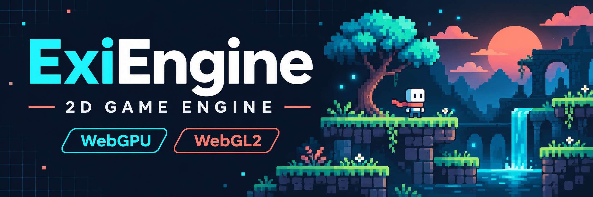
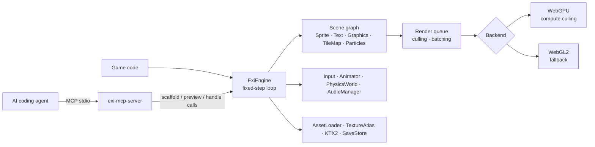

[](https://github.com/ozkantasli/ExiEngine/actions/workflows/ci.yml)
[](LICENSE)
[](package.json)
[](.github/workflows/ci.yml)
[](docs/internal/ADR-001-language-graphics-api.md)
[](package.json)
[](test/unit)
[](CONTRIBUTING.md)

**A dependency-free 2D game engine with its own core.**
ExiEngine brings the scene graph, sprite batching, tilemaps, particles, physics,
input, audio and asset loading together in a single JavaScript API. It renders
with WebGPU first and falls back to WebGL2. At runtime it depends on no other game
engine and no npm package; Node.js is only needed for the demo server, the tests
and the MCP bridge.

What sets it apart from other 2D engines is that it is **AI-native**: a built-in
MCP bridge lets coding agents such as Claude Code, Codex, Gemini CLI and Cursor
discover the engine, scaffold a game, build scenes and verify the result in a real
browser.

> **Preview (v0.2):** APIs, configuration and behavior can change between releases.
> Node tests are not a substitute for real GPU evidence, and the physical mobile
> device matrix is not complete yet. See [Limitations](#limitations).

[Get started](#getting-started) · [Documentation](#documentation) · [API](API.md) ·
[Using with AI agents](#using-with-ai-agents) · [Contribute](CONTRIBUTING.md)

## Features

⚡ WebGPU-first with automatic WebGL2 fallback and device-loss recovery</br>
📦 Zero runtime dependencies, one `import`</br>
🧩 Scene graph: Sprite, Text, Graphics, TileMap, ParticleEmitter, NineSlice, RenderGroup</br>
🚀 Instanced `SpriteBatch` with WebGPU compute culling, up to 100,000 sprites per batch</br>
🗺️ Instanced TileMap, Tiled (.tmj) import, collision-rect generation and A* pathfinding</br>
🧱 Lightweight physics: gravity, one-way and moving platforms, layers/masks, contact events</br>
🎱 Rigid bodies: rotating circles, boxes and convex polygons with friction, restitution and stable stacking</br>
🌐 Rollback netcode helper for deterministic multiplayer</br>
🔤 Bitmap fonts (BMFont .fnt/JSON) and 🔊 audio sprites, pitch and 2D spatial sound</br>
✨ Filters and post-processing: grayscale…saturate plus blur, glow, outline, pixelate, vignette on nodes or RenderGroups</br>
🎮 One action/axis input layer for keyboard, pointer, touch and gamepad</br>
🔊 Web Audio `AudioManager`: buses, fades, panning, voice budget</br>
🎨 Pixel-art friendly: nearest sampling, `roundPixels`, flipX/flipY, atlas animations</br>
🛡️ Safe defaults: same-origin assets, byte/pixel budgets, fixed shaders, CSP</br>
🤖 MCP bridge: agents discover the engine, build games and verify them in the browser</br>
📐 TypeScript definitions (`index.d.ts`), 225 unit tests and 25 allocation benchmarks</br>

Full list and behavior details: [FEATURES.md](FEATURES.md)

## Getting started

| Your goal | Start here | What you get |
|---|---|---|
| **Try the engine** | [Run the demo](#run-the-demo) | A live scene you can switch between Auto / WebGL2 / WebGPU, with FPS/draw/node stats |
| **Learn from a game** | [Examples](#examples) | Small complete games: platformer (Tiled), top-down arena, UI menu |
| **Build a level visually** | [Editor](#editor) | Browser scene editor: hierarchy, inspector, drag/snap, tile painting, JSON save/load |
| **Write a game** | [Quick start](#quick-start) and [API.md](API.md) | Your first game loop with scene, camera, input and physics |
| **Build a game with an AI agent** | [Using with AI agents](#using-with-ai-agents) | Scaffolding, scene generation and browser preview over MCP |
| **Contribute** | [Development](#development) | Tests, lint, coverage and the release gate |

### Run the demo

**Node.js 22 or 24** is all you need; there is no `npm install` step.

```bash
git clone https://github.com/ozkantasli/ExiEngine.git
cd ExiEngine
npm run dev
```

Then open `http://127.0.0.1:4173/` in your browser. The server listens on loopback
only and sends CSP/`nosniff` headers.

### Examples

`npm run dev`, then open `http://127.0.0.1:4173/examples/`. Every example is a single
`main.js` that imports only `src/index.js` and ships without binary assets.

| Example | Shows |
|---|---|
| [`examples/platformer`](examples/platformer/main.js) | `TileMap.fromTiled` level, tile-property collision bodies, gravity, coyote time / jump buffering, camera follow + bounds, HUD overlay |
| [`examples/top-down`](examples/top-down/main.js) | Code-built TileMap walls, zero-gravity physics, trigger pickups, A* (`findGridPath`) chasers, particles, camera shake |
| [`examples/physics`](examples/physics/main.js) | `RigidBodyWorld`: boxes, circles, convex polygons, rotation, friction, restitution, a standing pyramid, click to drop shapes |
| [`examples/ui-menu`](examples/ui-menu/main.js) | Overlay UI, pointer + keyboard focus (Tab/Enter), tweened buttons, `StateMachine` screens |

`npm test` checks the examples statically; `npm run test:e2e:examples` runs them in a real
Chromium through Playwright.

### Editor

`npm run dev`, then open `http://127.0.0.1:4173/editor/`. The editor is plain HTML/JS on
top of the engine (no dependencies) and edits a live ExiEngine scene:

- **Hierarchy** and **inspector** for `Scene`, groups, `Sprite`, `NineSliceSprite` panels,
  `Text`, `Graphics` shapes and `TileMap`s (transform, alpha, z-index, visibility, filters,
  blend mode, sprite/text style, textures)
- **Viewport**: click to select, drag to move with grid snapping (Shift = free), wheel zoom,
  right/middle/Space-drag pan, arrow-key nudge, `F` to frame the scene
- **Tile painting** (`P`): left-drag paints the chosen tile, right/Alt-drag erases
- **Undo/redo**, duplicate, delete, image import as textures, autosave in the browser
- **Save/Open** produce and read the same JSON document as `serializeScene()` /
  `deserializeScene()`, so a game loads an edited level with one call:

```js
const level = await loader.loadJSON("./level.json");
engine.setScene(deserializeScene(level, { textures: { "tiles.png": tilesTexture } }));
```

Textures are referenced by id (the imported file name); scripts and callbacks stay in your
game code. `window.editor` exposes the same operations for scripting and AI agents.

### Install

The package is npm-ready (`npm pack` / `npm publish` produce a tarball with `src/`,
prebuilt single-file bundles in `dist/` and `index.d.ts`). There are no runtime
dependencies, so any of these work:

```bash
npm install exi-engine            # once published; or: npm install github:ozkantasli/ExiEngine
```

```js
import { ExiEngine, Scene, Sprite } from "exi-engine";             // bundlers / import maps
import { ExiEngine } from "./ExiEngine/src/index.js";              // straight from a checkout
import { ExiEngine } from "./vendor/exi-engine.js";                // copied dist/exi-engine.js (one file)
```

```html
<!-- No build step: classic script tag, exposes globalThis.Exi -->
<script src="./vendor/exi-engine.global.js"></script>
<script>const { ExiEngine, Scene } = Exi;</script>
```

`npm run build` writes `dist/exi-engine.js` (ES module) and `dist/exi-engine.global.js`
(classic script) with the zero-dependency bundler in `tools/build.mjs`. Once the package
is on npm, the same files are served by CDNs such as
`https://cdn.jsdelivr.net/npm/exi-engine@<version>/dist/exi-engine.js`.

### Quick start

```js
import { ExiEngine, Scene, Sprite, Camera } from "exi-engine";

const scene = new Scene();
const player = new Sprite({
  x: 100, y: 100, width: 32, height: 32, tint: 0x6fffc0,
  onUpdate: (dt, node) => { node.position.x += 120 * dt; },
});
scene.add(player);

const engine = await ExiEngine.create({
  canvas: document.querySelector("canvas"),
  renderer: "auto",            // "webgpu" | "webgl2" | "auto"
  backgroundColor: "#060912",
  scene,
  camera: new Camera(),
  inputActions: { jump: ["Space", { type: "gamepad", button: 0 }] },
});
engine.start();
```

Examples for camera follow, overlay HUDs, RenderTexture, physics and pointer events
are in [API.md](API.md).

## Overview



| Folder | Contents |
|---|---|
| [`src/core`](src/core) | Engine, scene graph, renderables, camera, input, animation, collision/physics, pathfinding, profiler |
| [`src/render`](src/render) | WebGPU and WebGL2 renderers, batching, instancing, scissor, post-process |
| [`src/assets`](src/assets) | AssetLoader, Texture, RenderTexture, TextureAtlas, KTX2, SaveStore |
| [`src/audio`](src/audio) | Web Audio based AudioManager |
| [`src/ai`](src/ai) | In-browser RuntimeAgent (the target of MCP preview calls) |
| [`tools`](tools) | Zero-dependency MCP bridge and lint tool |
| [`test`](test) | Smoke, unit, typecheck, coverage, e2e and benchmarks |

The rationale for the language and graphics API choice is in [ADR-001](docs/internal/ADR-001-language-graphics-api.md).

## Using with AI agents

The repository ships ready-made MCP configuration for common AI CLIs. When an agent
opens the folder, it finds the `exi-engine` server automatically.

| Client | Configuration |
|---|---|
| Claude Code | [`.mcp.json`](.mcp.json), [`CLAUDE.md`](CLAUDE.md) |
| Codex | [`.codex/config.toml`](.codex/config.toml), [`AGENTS.md`](AGENTS.md) |
| OpenCode | [`opencode.json`](opencode.json), [`AGENTS.md`](AGENTS.md) |
| Gemini CLI | [`.gemini/settings.json`](.gemini/settings.json), [`GEMINI.md`](GEMINI.md) |
| Cursor CLI | [`.cursor/mcp.json`](.cursor/mcp.json) |
| Cline CLI | [`.cline/mcp.json`](.cline/mcp.json) |
| Windsurf / others | The direct Node command in [MCP.md](MCP.md) |

To start the bridge manually:

```bash
node tools/exi-mcp-server.mjs
```

> Do not use `npm run mcp` as the MCP stdio command; npm's banner gets mixed into stdout.

A typical agent flow: discover the engine with `exi_api` → `exi_scaffold` (new game)
or `exi_project_open` (existing game) → write files with `exi_project_apply` →
check and open in the browser with `exi_project_preview` → verify live engine state
with `exi_preview_call`. All tools and their safety limits:
[AI_ENGINE_GUIDE.md](AI_ENGINE_GUIDE.md), [MCP.md](MCP.md).

## Development

| Command | What it does |
|---|---|
| `npm run doctor` | Fast environment, export and agent-contract check |
| `npm test` | Static, server, engine smoke, unit, typecheck, build and examples stages |
| `npm run test:unit` | Unit tests only |
| `npm run lint` | Zero-dependency syntax and anti-pattern scan |
| `npm run build` | Single-file ESM + global bundles in `dist/` (also runs on `npm pack`) |
| `npm run test:coverage` | Unit suite coverage thresholds |
| `npm run test:mcp` | Modern and legacy MCP end-to-end smoke test |
| `npm run test:e2e:browser` | Real Chrome/Chromium canvas and runtime telemetry test (`EXI_PLAYWRIGHT_EXECUTABLE` / `EXI_PLAYWRIGHT_CHANNEL` pick the browser) |
| `npm run test:e2e:examples` | Opens every example in real Chromium, drives input and checks for errors |
| `npm run test:clients` | Real handshake test for every client config in the repo |
| `npm run verify` | Release gate: `npm test` plus all benchmarks |
| `npm run bench:regression` | Benchmark drift check against the local baseline |
| `npm run bench -- <name>` | A single benchmark (`sprite`, `tilemap`, `physics` …); `npm run bench` lists all names |

CI ([`ci.yml`](.github/workflows/ci.yml)) runs test, lint, typecheck, verify,
coverage and preview-e2e jobs on Node 22 and 24 for every push and pull request.

For real GPU/audio/input soak testing, open
`http://127.0.0.1:4173/test/hardware-soak.html` while the demo server is running.
Physical device results are collected in [test/HARDWARE_MATRIX.md](test/HARDWARE_MATRIX.md).

## Documentation

> Most project documents are currently written in Turkish.

| Topic | Document |
|---|---|
| Runtime and MCP API reference with examples | [API.md](API.md) |
| Agent and contributor contract (canonical) | [AI_ENGINE_GUIDE.md](AI_ENGINE_GUIDE.md) |
| MCP client setup | [MCP.md](MCP.md) |
| All features and behavior details | [FEATURES.md](FEATURES.md) |
| Threat model and security contract | [SECURITY.md](SECURITY.md) |
| Product requirements | [PRD.md](docs/internal/PRD.md) |
| Roadmap | [ROADMAP.md](ROADMAP.md) |
| Comparison with other engines | [ENGINE_GAP_ANALYSIS.md](docs/internal/ENGINE_GAP_ANALYSIS.md) (web 2D: Phaser, PixiJS, Excalibur, KAPLAY, melonJS, GDevelop, Construct, Godot web), [ENGINE_FEATURE_MATRIX.md](docs/internal/ENGINE_FEATURE_MATRIX.md) (broad survey) |
| Research gaps | [RESEARCH_GAPS.md](docs/internal/RESEARCH_GAPS.md) |
| Implicit state machine audit | [IMPLICIT_STATE_MACHINES.md](docs/internal/IMPLICIT_STATE_MACHINES.md) |

## FAQ

> Does it support 3D?

No. ExiEngine is deliberately a 2D-first core; 3D is a long-term goal outside the
current roadmap.

> What happens if the browser doesn't support WebGPU?

`renderer: "auto"` tries WebGPU first and starts with WebGL2 if it isn't available.
If the WebGPU device is lost at runtime, the engine switches to WebGL2; on a WebGL2
context loss, resources are rebuilt.

> Do I need Node.js to ship my game?

No. Node is only for the dev server, the tests and the MCP bridge. Your game can be
served as static files from any HTTPS server.

> Can I install it from npm?

Not yet. The package is marked `private`; for now, clone the repository and import
`src/index.js`.

> Is there a full rigid-body physics engine?

No. `PhysicsWorld` is a lightweight, axis-separated AABB solver for platformers and
top-down games. Rotation and impulse solving are intentionally left out of the core.

> Does it run on mobile?

It is designed for mobile browsers (`maxPixelRatio`, touch input, pausing when
hidden), but the physical iOS/Android device matrix is not complete yet.

## Limitations

ExiEngine is a **core** with a lightweight scene editor: it edits and saves scenes, but it
does not yet have hot reload, animation timelines, prefab/asset management or a play-in-
editor mode, which full engines provide. Device-loss and fallback flows are verified with simulated smoke
tests; real GPU memory soak, driver resets and physical device testing must be done
separately. Audio is subject to the browser's user-gesture policy. In production,
HTTPS and server-side security headers still need to be configured.

**tl;dr:** If you want an editor and a ready-made content pipeline, pick a full engine
like Godot. If you want a code-driven, dependency-free 2D web core that AI agents can
drive directly, try ExiEngine.

## Roadmap

| Milestone | Status | Scope |
|---|---|---|
| MVP | ✅ | Dependency-free 2D core, scene graph, camera, input, MCP bridge |
| v0.2 | ✅ | Physics/collision, deterministic fixed step, A*, asset pipeline, safety limits, benchmark gate |
| v0.3 | ✅ (unreleased) | npm-ready package, Tiled import, examples, scene serialization, browser editor (first version), rigid bodies, post-process filters, BitmapText, audio sprites + spatial audio |
| v1.0 | 🛠️ | npm publish, editor v2 (play-in-editor, hot reload, prefabs), joints, Spine, lighting, GPU profiling, mobile device matrix |

Details: [ROADMAP.md](ROADMAP.md)

## Contributing and support

Contributions, bug reports and documentation improvements are welcome. Start with
[CONTRIBUTING.md](CONTRIBUTING.md) and [AI_ENGINE_GUIDE.md](AI_ENGINE_GUIDE.md).
Public API changes must ship together with `src/index.js`, `index.d.ts`, a matching
test and documentation.

- **Bugs and feature requests:** [GitHub Issues](https://github.com/ozkantasli/ExiEngine/issues)
- **Security vulnerabilities:** report them [privately on GitHub](https://github.com/ozkantasli/ExiEngine/security/advisories/new) instead of opening a public issue. Threat model: [SECURITY.md](SECURITY.md)

## License

ExiEngine is released under the [MIT License](LICENSE).

Copyright (c) 2026 Özkan Taşlı
